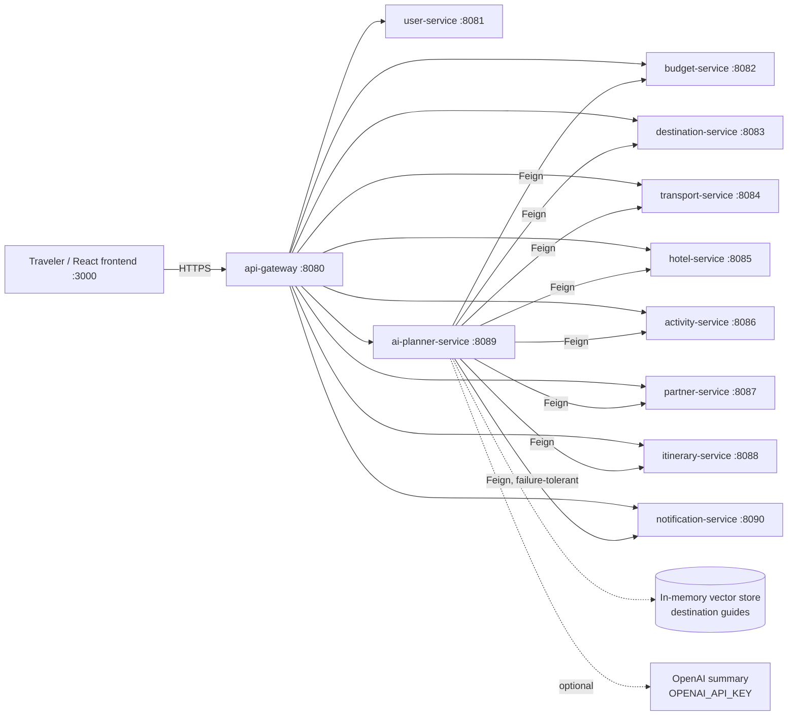

# Nethra Travel AI

### *"Where you can't see, we help you see."*

An **autonomous, budget-first travel planning platform** for India.

Traditional travel websites ask *"Where do you want to go?"* and then show you prices.
Nethra asks a different question — **"What is your budget?"** — and works backwards:

- You give a **budget**, a **source city**, a **number of days** and a **transport mode**.
- The system decides **where you can actually go**, **how to get there**, **where to stay**
  and **what to do each day** — day by day, hour-slot by hour-slot.
- Everything it recommends **must fit the budget**. Transport + hotel + food + activities +
  an 8% emergency buffer can never exceed what you said you can spend.
- If the trip is **not possible**, Nethra says so honestly: no itinerary, no fake plan —
  instead you get the **minimum budget that would work**, cheaper transport modes with
  their minimums, cheaper destinations, and concrete suggestions.

> **The spec example.** Hyderabad → anywhere, 4 days, by flight, ₹15,000?
> **Not possible.** The cheapest flight trip (to Mysuru) needs **₹15,196** once transport,
> stay, food, activities and the 8% safety buffer are counted. Nethra rejects the request
> and suggests train/bus/car alternatives and shorter trips instead. This behavior is
> covered by an automated test — see [The budget rules](#the-budget-rules).

---

## Table of contents

- [Screenshots](#screenshots)
- [Why "budget-first"?](#why-budget-first)
- [Architecture](#architecture)
- [Modules](#modules)
- [The agentic workflow](#the-agentic-workflow)
- [The budget rules](#the-budget-rules)
- [The dataset](#the-dataset)
- [API examples](#api-examples)
- [Quick start](#quick-start)
- [Local development](#local-development)
- [Testing](#testing)
- [Project structure](#project-structure)
- [Configuration](#configuration)
- [Deployment](#deployment)
- [Roadmap: Phase 1–4](#roadmap-phase-14)
- [Extending Nethra](#extending-nethra)
- [Honesty notes](#honesty-notes)
- [FAQ](#faq)

---

## Screenshots

_Screenshots of the running application will be added here._

| Screen | Placeholder |
|---|---|
| Login (demo credentials prefilled) | `docs/screenshots/login.png` |
| Plan Trip form (budget, source, days, mode) | `docs/screenshots/plan-form.png` |
| Feasible plan: destination, cost breakdown, day-by-day itinerary, agent trace | `docs/screenshots/plan-result.png` |
| Rejection card: minimum required budget + alternative modes/destinations | `docs/screenshots/rejection.png` |

---

## Why "budget-first"?

Most travel planning fails at the same place: money. People pick a destination from a
photo, then discover flights, hotels, food and activities add up to far more than they
can spend — or they underspend out of caution and miss out. Nethra inverts the flow:

1. **The budget is the input, not the output.** Every downstream decision — destination,
   transport, hotel tier, activities — is constrained by it from the first step.
2. **Feasibility before fantasy.** The system computes the *true minimum* cost of a trip
   (including food and a safety buffer, the two things people forget) before it dreams
   up an itinerary.
3. **A refusal is a feature.** When a trip cannot be done, Nethra explains *why*, shows
   the exact minimum, and offers the nearest achievable alternatives — a cheaper mode,
   a closer destination, a shorter trip. That is more useful than a plan that quietly
   busts the budget.
4. **Partners make trips cheaper.** Bundled partner packages (stay + pickup + tours) are
   checked *before* separate bookings, because a bundle that fits beats parts that don't.

---

## Architecture

Spring Boot 3.4.5 microservices (Java 21, Spring Cloud 2024.0.1) behind a Spring Cloud
Gateway, orchestrated by an agentic planner service, with a React 18 + TypeScript +
Material UI frontend. Every service runs standalone on embedded H2 by default — no
external database is needed to run the platform — and ships a PostgreSQL profile plus
DDL (`db/schema.sql`) for production-shaped deployments.



Full design notes, the plan-flow sequence diagram and the budget model are in
[`docs/ARCHITECTURE.md`](docs/ARCHITECTURE.md). Every endpoint is documented in
[`docs/API-CONTRACTS.md`](docs/API-CONTRACTS.md).

---

## Modules

| # | Module | Port | What it does |
|---|---|---|---|
| 1 | `common-lib` | — | Shared DTOs and records, INR money handling, `BudgetCategory` enum, the destination/activity/partner catalogs, the static transport pricing matrix, and `TripCostEstimator` — the single source of feasibility arithmetic. |
| 2 | `api-gateway` | 8080 | Spring Cloud Gateway (MVC). Routes `/api/**` and `/ai/**`, global CORS for the frontend, per-service URLs via environment variables. |
| 3 | `user-service` | 8081 | Registration and login, JWT issue/validate (jjwt 0.12.x), BCrypt hashing, in-memory user store seeded with the demo user. |
| 4 | `budget-service` | 8082 | Allocates a budget across TRANSPORT / HOTEL / FOOD / ACTIVITIES / EMERGENCY_BUFFER using mode-specific splits normalized to the 92% spendable share; feasibility precheck endpoint. |
| 5 | `destination-service` | 8083 | 14 curated destinations; scoring and ranking for (source, mode, budget, days); per-destination minimum estimates; guide text for RAG. |
| 6 | `transport-service` | 8084 | `TransportProvider` interface with mock flight/train/bus/car providers over the pricing matrix; deterministic variation by date hash. |
| 7 | `hotel-service` | 8085 | `HotelProvider` interface + mock provider; deterministic hotels per destination priced by cost index and budget tier, sorted by value score. |
| 8 | `activity-service` | 8086 | `ActivityProvider` interface + curated activities — 6 per destination, 84 in total — with price, duration and category. |
| 9 | `partner-service` | 8087 | Partner packages for 7 destinations; quotes bundle hotel + airport pickup + local tours below the sum of the parts. |
| 10 | `itinerary-service` | 8088 | Builds day-by-day plans: activities in morning/afternoon/evening slots, lighter arrival and departure days. |
| 11 | `ai-planner-service` | 8089 | **The orchestrator.** LangGraph-style `TravelGraph` with 8 agent nodes, Feign clients to all services, MCP-style tool registry, hashing-embedding RAG over destination guides, optional OpenAI summary with deterministic fallback, plan persistence. |
| 12 | `notification-service` | 8090 | Accepts EMAIL/SMS/ALERT notification requests, mock-sends by logging, stores history. Called by the planner when a plan completes (failure-tolerant). |
| 13 | `frontend` | 3000 | React 18 + TypeScript + Vite + Material UI. Login, Plan Trip form, plan result (destination hero, cost-breakdown bar, itinerary cards, agent-trace timeline) and the rejection card with clickable alternatives. Served by nginx proxying `/api/` and `/ai/` to the gateway. |

---

## The agentic workflow

Planning is a **LangGraph-style state machine** (`TravelGraph`) of eight agent classes,
each in its own file, executed in a fixed order over a shared `TravelState`. Every agent
appends `{agent, decision, detail}` to an **agent trace** that is returned with the plan —
the workflow is fully auditable.

| Step | Agent | Responsibility | Example decisions |
|---|---|---|---|
| 1 | `BudgetAnalysisAgent` | Calls budget-service; allocates the budget across the 5 categories. | `ALLOCATED` |
| 2 | `FeasibilityAgent` | Pulls per-destination minimum estimates; compares the cheapest true minimum with the budget. | `FEASIBLE`, `REJECTED` |
| 3 | `DestinationSelectionAgent` | Ranks destinations (score = value-for-money weighted by budget fit, distance cost, rating, days fit); enriches with RAG guide excerpts. | `DESTINATION_SELECTED` |
| 4 | `TransportationAgent` | Picks the best transport option in the requested mode within the transport allocation. | `TRANSPORT_SELECTED` |
| 5 | `HotelSelectionAgent` | **Partner packages first**: if a package fits, it wins and the hotel provider is never called; otherwise best-value hotel. | `PARTNER_PACKAGE_SELECTED`, `HOTEL_SELECTED` |
| 6 | `ActivitySelectionAgent` | Selects curated activities that fit the activities budget (skipped when a partner package bundles tours). | `ACTIVITIES_SELECTED`, `ACTIVITIES_FROM_PACKAGE` |
| 7 | `ItineraryPlanningAgent` | Calls itinerary-service to lay activities into day-by-day slots. | `ITINERARY_BUILT` |
| 8 | `BudgetValidationAgent` | Recomputes the final total and checks the hard invariant; trims activities and re-validates if over. | `VALIDATED`, `TRIMMED_ACTIVITIES` |

On success the planner persists the plan, fires a notification (failures tolerated) and
returns the plan with a summary — generated by OpenAI **only if** `OPENAI_API_KEY` is set,
otherwise by a deterministic template. The platform works completely with **no API key**.

### MCP-style tool registry

`GET /ai/tools` exposes the planner's capabilities as tool definitions (name, description,
JSON input schema) — `plan_trip` plus the supporting ranking, minimum-estimation and
budget-allocation tools — so an external agent host can drive Nethra as tools.

### RAG over destination guides

Each destination ships guide text. A 128-dimension **hashing embedder** indexes the guides
in an in-memory vector store; the destination agent retrieves the most relevant excerpts
for the chosen destination and returns them as `guideHighlights` with the plan. It is a
small, dependency-free retrieval layer — honest about what it is, and shaped so a real
embedding model can replace the hasher without touching the agents.

---

## The budget rules

These rules are implemented exactly, and each is covered by tests:

1. **Five categories, always reported:** `TRANSPORT`, `HOTEL`, `FOOD`, `ACTIVITIES`,
   `EMERGENCY_BUFFER`.
2. **The buffer is sacred:** `EMERGENCY_BUFFER = 8%` of the budget, held back. Spendable
   categories are sized from the remaining 92%.
3. **The invariant:** `transport + hotel + food + activities + buffer ≤ budget`. The
   final agent re-checks it before any plan is returned; if a plan is over, activities
   are trimmed and the check runs again.
4. **Infeasible means infeasible:** if the cheapest true minimum for the requested
   (source, mode, days) exceeds the budget, the response is a rejection —
   `feasible=false`, `itinerary=null`, a computed `minimumRequiredBudget`,
   `alternativeTransportModes` (each cheaper mode with its own minimum),
   `alternativeDestinations` (cheaper destinations with minimums) and `suggestions`
   (e.g. the cost of a shorter trip). Still HTTP 200 — a rejection is a valid answer,
   not a server error.
5. **Partner packages first:** a fitting package replaces separate hotel + activities.
6. **Minimums are computed, not guessed:** for each destination,
   `minimum = (cheapest transport in mode + food + min(lodging+activities, package quote)) / 0.92`.
   The division grosses the subtotal up so the 8% buffer is *inside* the required budget.

**The spec example, worked:** Hyderabad, 4 days, flight, 1 traveler. Cheapest destination
is Mysuru: flight ₹5,280 + lodging/activities ₹5,100 + food ₹3,600 = ₹13,980;
₹13,980 / 0.92 = **₹15,196 > ₹15,000 → rejected**, with TRAIN/BUS/CAR minimums offered.
The cheapest 3-day train trip from Hyderabad needs only ₹8,250 (Varanasi), which is why
the same ₹15,000 succeeds by train.

---

## The dataset

All inventory is **curated mock data** — deterministic and labeled as mock in code:

- **14 destinations:** Goa, Manali, Jaipur, Kochi (Kerala), Agra, Varanasi, Rishikesh,
  Udaipur, Mysuru, Pondicherry, Darjeeling, Hyderabad, Bengaluru, Mumbai — each with base
  hotel/food costs, coordinates, rating, ideal days, tags and guide text.
- **Transport pricing:** a static, distance-based matrix. Great-circle distance from
  coordinates; road distance = air distance × 1.28. Flight = max(₹4,700, ₹3,600 +
  ₹2.8/km); train, bus and car use their own per-km formulas with floors. It prices trips
  from **any** source city — including the six major hubs Hyderabad, Delhi, Mumbai,
  Bengaluru, Chennai and Kolkata — to every destination, per mode.
- **Activities:** 6 curated activities per destination (84 total) with realistic names,
  prices, durations and categories.
- **Partner packages:** 7 packages (Goa, Manali, Jaipur, Kochi, Udaipur, Darjeeling,
  Mysuru), each bundling per-night stay + a tour bundle priced below the separate parts.
- **Hotels:** generated deterministically per destination (name patterns, star tiers)
  and priced by the destination's cost index and the traveler's budget tier.

---

## API examples

### Plan a trip (feasible)

```bash
curl -s -X POST http://localhost:8080/ai/plan -H 'Content-Type: application/json' -d '{
  "budgetInr": 15000, "sourceCity": "Hyderabad", "days": 3,
  "transportMode": "TRAIN", "travelers": 1
}'
```

Returns `feasible: true` with destination **Bengaluru**, a 3-day itinerary, a category
breakdown whose `EMERGENCY_BUFFER` is exactly ₹1,200 (8%), `totalCost ≤ 15000`, and the
full agent trace. (Exact option prices come from the mock providers at runtime; the
invariants above are what the tests assert.)

### The rejection

```bash
curl -s -X POST http://localhost:8080/ai/plan -H 'Content-Type: application/json' -d '{
  "budgetInr": 15000, "sourceCity": "Hyderabad", "days": 4,
  "transportMode": "FLIGHT", "travelers": 1
}'
```

```json
{
  "feasible": false,
  "itinerary": null,
  "minimumRequiredBudget": 15196.00,
  "reason": "No destination is reachable from Hyderabad by FLIGHT for 4 day(s) within ₹15,000. The cheapest option (Mysuru) needs at least ₹15,196 including the 8% emergency buffer.",
  "alternativeTransportModes": [
    { "transportMode": "TRAIN", "minimumRequiredBudget": "...", "cheapestDestinationName": "..." },
    { "transportMode": "BUS",   "minimumRequiredBudget": "...", "cheapestDestinationName": "..." },
    { "transportMode": "CAR",   "minimumRequiredBudget": "...", "cheapestDestinationName": "..." }
  ],
  "alternativeDestinations": [
    { "destinationName": "Mysuru", "minimumRequiredBudget": 15196.00 }
  ],
  "suggestions": ["Try a cheaper transport mode", "Shorten the trip", "Increase the budget to at least the minimum shown"]
}
```

### Allocate a budget

```bash
curl -s -X POST http://localhost:8080/api/budget/allocate -H 'Content-Type: application/json' -d '{
  "budgetInr": 15000, "days": 4, "travelers": 1, "transportMode": "FLIGHT"
}'
```

```json
{ "totalBudget": 15000.00, "spendableBudget": 13800.00, "emergencyBuffer": 1200.00,
  "allocations": { "TRANSPORT": 5400.00, "HOTEL": 4050.00, "FOOD": 2400.00,
                   "ACTIVITIES": 1950.00, "EMERGENCY_BUFFER": 1200.00 } }
```
*(Captured from the running budget-service.)*

### Login (demo user)

```bash
curl -s -X POST http://localhost:8080/api/users/login -H 'Content-Type: application/json' -d '{
  "email": "demo@nethra.ai", "password": "password123"
}'
```

### Rank destinations / minimums / tools

```bash
curl -s 'http://localhost:8080/api/destinations/rank?sourceCity=Hyderabad&transportMode=TRAIN&budgetInr=15000&days=3&travelers=1'
curl -s 'http://localhost:8080/api/destinations/minimums?sourceCity=Hyderabad&transportMode=FLIGHT&days=4&travelers=1'
curl -s  http://localhost:8080/ai/tools
```

The complete contract for every endpoint is in
[`docs/API-CONTRACTS.md`](docs/API-CONTRACTS.md).

---

## Quick start

### Docker Compose (recommended)

```bash
docker compose up --build
```

- Frontend: http://localhost:3000
- Gateway: http://localhost:8080
- Log in with `demo@nethra.ai / password123`, or plan a trip straight away.

### Local jars

```bash
mvn -q -DskipTests package
java -jar budget-service/target/budget-service-1.0.0.jar        # 8082
java -jar destination-service/target/destination-service-1.0.0.jar # 8083
java -jar transport-service/target/transport-service-1.0.0.jar   # 8084
java -jar hotel-service/target/hotel-service-1.0.0.jar           # 8085
java -jar activity-service/target/activity-service-1.0.0.jar     # 8086
java -jar partner-service/target/partner-service-1.0.0.jar       # 8087
java -jar itinerary-service/target/itinerary-service-1.0.0.jar   # 8088
java -jar notification-service/target/notification-service-1.0.0.jar # 8090
java -jar ai-planner-service/target/ai-planner-service-1.0.0.jar # 8089
java -jar user-service/target/user-service-1.0.0.jar             # 8081
java -jar api-gateway/target/api-gateway-1.0.0.jar               # 8080
cd frontend && npm install && npm run build   # or: npm run dev
```

More detail in [`docs/LOCAL-DEVELOPMENT.md`](docs/LOCAL-DEVELOPMENT.md).

---

## Local development

- **Java 21 + Maven 3.9+**, Node 20+ for the frontend. Nothing else: H2 is embedded,
  inventory is in-repo, the LLM is optional.
- Services find each other at `localhost` ports by default; override with
  `BUDGET_SERVICE_URL`, `DESTINATION_SERVICE_URL`, … (see
  [Configuration](#configuration)).
- PostgreSQL: add `--spring.profiles.active=postgres` with `DB_URL`, `DB_USERNAME`,
  `DB_PASSWORD`; DDL is in `db/schema.sql`.
- Frontend API base: `VITE_API_URL` (default same-origin via the nginx proxy).

---

## Testing

```bash
mvn -q test
```

| Suite | Tests | What it proves |
|---|---|---|
| `BudgetServiceTest` (budget-service) | 3 | Allocations sum to the budget; buffer is exactly 8%; mode splits normalize to the spendable share. |
| `DestinationServiceTest` (destination-service) | 4 | Catalog completeness (14 destinations); scoring/ranking behavior; minimum estimates are sane and ordered. |
| `TravelGraphIntegrationTest` (ai-planner-service) | 3 | **Spec rejection:** Hyderabad/4d/FLIGHT/₹15,000 → infeasible, minimum ₹15,196 > budget, TRAIN alternative present. **Feasible trip:** Hyderabad/3d/TRAIN/₹15,000 → Bengaluru, 3 itinerary days, total ≤ budget, buffer ₹1,200. **Partner priority:** Goa package selected when it fits; hotel client verified *never called*. Feign clients are mocked; the full graph runs end-to-end. |
| `RagServiceTest` (ai-planner-service) | 1 | Guide retrieval returns relevant excerpts for a destination query. |

**Verified build results (this repo):**

- `mvn -q -DskipTests package` — **green**, all 12 Maven modules.
- `mvn -q test` — **green**: 11 tests, 0 failures.
- `cd frontend && npm install && npm run build` — **green** (TypeScript + Vite, MUI).
- Services boot individually and answer health + endpoint calls (budget allocation
  response above was captured live). Note: the build sandbox intercepts raw TCP sockets
  from JVMs, so the cross-service runtime path is verified by the integration tests
  rather than a live multi-service smoke run in that environment; on a normal host or
  under Docker Compose the Feign calls run as configured.

---

## Project structure

```
nethra-travel-ai/
├── pom.xml                     # aggregator (Spring Boot 3.4.5, Cloud 2024.0.1)
├── docker-compose.yml          # all services + gateway + frontend
├── db/schema.sql               # PostgreSQL DDL matching the JPA entities
├── docs/
│   ├── ARCHITECTURE.md         # design, Mermaid diagrams, budget model
│   ├── API-CONTRACTS.md        # every endpoint with examples
│   └── LOCAL-DEVELOPMENT.md    # dev setup, tests, profiles
├── k8s/                        # per-service Deployment+Service, namespace, ingress
├── helm/nethra-travel-ai/      # Helm chart templating all services
├── .github/workflows/ci.yml    # Maven verify + frontend build
├── common-lib/                 # DTOs, catalogs, pricing matrix, TripCostEstimator
├── api-gateway/                # :8080
├── user-service/               # :8081  JWT auth, demo user
├── budget-service/             # :8082  allocation + precheck
├── destination-service/        # :8083  catalog, scoring, minimums
├── transport-service/          # :8084  mock flight/train/bus/car providers
├── hotel-service/              # :8085  mock hotels
├── activity-service/           # :8086  curated activities
├── partner-service/            # :8087  partner packages
├── itinerary-service/          # :8088  day-by-day planner
├── ai-planner-service/         # :8089  TravelGraph, agents, RAG, tools
├── notification-service/       # :8090  mock notifications + history
└── frontend/                   # React 18 + TS + Vite + MUI (nginx image)
```

Each Java module carries a multi-stage `Dockerfile`.

---

## Configuration

| Variable | Used by | Default |
|---|---|---|
| `BUDGET_SERVICE_URL` … `NOTIFICATION_SERVICE_URL` | planner, gateway | `http://localhost:<port>` |
| `USER_SERVICE_URL`, `AI_PLANNER_SERVICE_URL`, … | gateway | `http://localhost:<port>` |
| `OPENAI_API_KEY` | planner | *(unset — template summaries)* |
| `OPENAI_MODEL` | planner | `gpt-4o-mini` |
| `DB_URL`, `DB_USERNAME`, `DB_PASSWORD` | all services (postgres profile) | local H2 |
| `VITE_API_URL` | frontend build | same-origin (nginx proxy) |
| `JWT_SECRET` | user-service | development default (change in production) |

---

## Deployment

- **Docker Compose:** `docker-compose.yml` wires all 11 services + gateway + frontend
  with service-name URLs.
- **Kubernetes:** `k8s/` has one Deployment + Service per service, a `nethra` namespace
  and an nginx Ingress (`/` → frontend, `/api` + `/ai` → gateway).
- **Helm:** `helm/nethra-travel-ai/` renders the same topology from `values.yaml`.
- **CI:** `.github/workflows/ci.yml` runs `mvn verify` and the frontend production build
  on every push/PR to `main`.

---

## Roadmap: Phase 1–4

| Phase | Scope | Status |
|---|---|---|
| **Phase 1 — MVP: rules + mock providers** | Budget engine with the 8% buffer rule, curated destination/activity/partner datasets, mock transport/hotel providers, feasibility rejection with computed minimums. | ✅ **Implemented** (this repo) |
| **Phase 2 — Agentic workflow** | LangGraph-style `TravelGraph` with 8 auditable agents, RAG over destination guides, MCP-style tool registry, optional LLM summaries with deterministic fallback. | ✅ **Implemented** (this repo) |
| **Phase 3 — Partner network** | Onboard real partner hotels/tour operators; live package inventory, negotiated rates, partner quote API replacing the static catalog behind the same interface. | 🔌 Designed for extension — provider interfaces and package-first logic are in place; partner data is currently a curated static dataset. |
| **Phase 4 — Production scale** | Real transport/hotel aggregator APIs, booking + payments, user accounts at scale (PostgreSQL profile already ships), observability, caching, multi-region deployment. | 🔌 Designed for extension — interfaces, Postgres DDL and k8s/Helm assets are in place; no real booking or payment integration yet. |

---

## Extending Nethra

- **Add a real transport provider:** implement `TransportProvider` in transport-service
  (one method: options for source/destination/mode/date/travelers) and register it for
  its mode. The planner, pricing rules and tests do not change.
- **Add a destination:** add a `DestinationProfile` (costs, coordinates, rating, ideal
  days, guide text) and its activities to the catalogs in `common-lib`. Pricing,
  minimums, scoring and RAG pick it up automatically.
- **Add a partner package:** add a `PartnerPackage` for the destination; the
  package-first rule applies immediately.
- **Swap the embedder:** replace the hashing embedder behind the RAG service interface
  with a real embedding model; agents keep calling the same retrieval API.

---

## Honesty notes

- **All travel inventory is mock data.** Providers are named `Mock*Provider` in code and
  called mock throughout these docs. Prices are deterministic planning estimates from a
  documented static model — **not** live fares, and nothing here can be booked.
- **No payments, no bookings.** Nethra plans trips; it does not purchase anything.
- **The "AI" is explicit:** a rules-and-graph workflow with retrieval and an optional
  LLM summary. With no `OPENAI_API_KEY` it runs fully on deterministic logic — by
  design, so a budget decision is never a black box.
- **Numbers in this README are real outputs** of the code in this repo (the ₹15,196
  minimum and the allocation example were produced by the estimator/service, and the
  invariants are asserted by tests), not marketing copy.

---

## FAQ

**Why reject instead of just showing the cheapest plan anyway?**
Because a plan that exceeds the stated budget breaks the one promise the product makes.
The rejection still helps: it shows the exact minimum and the nearest alternatives.

**Why is the emergency buffer 8%?**
Trips always cost more than the spreadsheet — a missed train, a price change, one
unplanned taxi. Holding 8% back means the plan survives reality; the buffer is reported
as its own category so the traveler sees it, not a hidden markup.

**Can it plan from cities other than the six hubs?**
Yes — pricing is distance-based from coordinates, so any source city in the catalog
(and the 14 destinations themselves) works as an origin.

**Does it need an OpenAI key?**
No. The key only upgrades the plan *summary* prose. Planning, feasibility, pricing and
itineraries are fully deterministic without it.

**Is multi-traveler supported?**
Yes — transport scales per traveler (except car, priced per vehicle), rooms are
`ceil(travelers / 2)`, food and activities scale per person.

**Why H2 by default?**
So the whole platform runs anywhere with zero setup. The PostgreSQL profile and
`db/schema.sql` are there when you want a real database.

---

*Built as a complete, compile-verified multi-module project: 12 Maven modules, a React
frontend, Docker/Kubernetes/Helm assets, and tests that encode the budget rules —
including the one that says "no" when the numbers don't work.*


---

# Appendix A — Destination catalog (all 14)

Per-destination base data lives in `common-lib` (`TravelCatalog`). Hotel base is the
reference per-night rate before budget-tier scaling; food is per person per day.

| Destination | State | Rating | Hotel base /night | Food /day | Planning notes |
|---|---|---|---|---|
| Goa | Goa | 4.8 | ₹2,400 | ₹1,300 | Partner package available; strong value outside peak season |
| Manali | Himachal Pradesh | 4.7 | ₹2,100 | ₹1,100 | Partner package available; weather affects Rohtang access |
| Jaipur | Rajasthan | 4.6 | ₹1,800 | ₹1,000 | Partner package available; compact sightseeing distances |
| Kochi (Kerala) | Kerala | 4.6 | ₹1,700 | ₹950 | Partner package available (Kerala Partner Package) |
| Agra | Uttar Pradesh | 4.4 | ₹1,500 | ₹900 | Best as a short, focused trip |
| Varanasi | Uttar Pradesh | 4.5 | ₹1,300 | ₹800 | Cheapest 3-day train minimum from Hyderabad in the dataset (₹8,250) |
| Rishikesh | Uttarakhand | 4.6 | ₹1,400 | ₹850 | Low-cost activities keep minimums down |
| Udaipur | Rajasthan | 4.7 | ₹1,900 | ₹1,000 | Partner package available |
| Mysuru | Karnataka | 4.4 | ₹1,500 | ₹900 | **Cheapest flight destination from Hyderabad** — the spec example's minimum (₹15,196) is computed against Mysuru |
| Pondicherry | Puducherry | 4.5 | ₹1,700 | ₹1,000 | Gentle pace; low daily costs |
| Darjeeling | West Bengal | 4.6 | ₹1,800 | ₹950 | Partner package available; longer surface journeys |
| Hyderabad | Telangana | 4.5 | ₹1,800 | ₹1,000 | Also a valid destination (e.g. for travelers from Delhi) |
| Bengaluru | Karnataka | 4.3 | ₹1,850 | ₹1,100 | The feasible destination in the train test case from Hyderabad |
| Mumbai | Maharashtra | 4.5 | ₹2,600 | ₹1,300 | Highest hotel base in the catalog; plan transport carefully |

# Appendix B — Agent trace, decoded

A real plan response carries a trace like the following (agent names and decision verbs
are the actual ones emitted by the code):

| Trace entry | Meaning |
|---|---|
| `BudgetAnalysisAgent: ALLOCATED` | Budget split across the 5 categories; buffer fixed at 8%. |
| `FeasibilityAgent: FEASIBLE` / `REJECTED` | Cheapest true minimum vs budget. On `REJECTED` the graph stops and returns the rejection object. |
| `DestinationSelectionAgent: DESTINATION_SELECTED` | Highest-scoring feasible destination chosen; RAG excerpts attached. |
| `TransportationAgent: TRANSPORT_SELECTED` | Best in-mode option within the transport allocation. |
| `HotelSelectionAgent: PARTNER_PACKAGE_SELECTED` | A partner package fit — chosen over separate hotel + activities. |
| `HotelSelectionAgent: HOTEL_SELECTED` | No fitting package; best-value hotel chosen. |
| `ActivitySelectionAgent: ACTIVITIES_SELECTED` | Activities picked within the activities allocation. |
| `ActivitySelectionAgent: ACTIVITIES_FROM_PACKAGE` | Tours come from the partner bundle; no separate selection. |
| `ItineraryPlanningAgent: ITINERARY_BUILT` | Day-by-day slots produced by itinerary-service. |
| `BudgetValidationAgent: VALIDATED` | Final total re-checked against the invariant. |
| `BudgetValidationAgent: TRIMMED_ACTIVITIES` | Plan was over; activities were cut and the plan re-validated. |

# Appendix C — Worked budget examples

All figures are outputs of `TripCostEstimator` / budget-service with the shipped dataset.

**C.1 Allocation — ₹15,000, 4 days, FLIGHT, 1 traveler** (captured live from
budget-service): spendable ₹13,800; TRANSPORT ₹5,400; HOTEL ₹4,050; FOOD ₹2,400;
ACTIVITIES ₹1,950; EMERGENCY_BUFFER ₹1,200. Sum = ₹15,000 exactly.

**C.2 The spec rejection — Hyderabad, 4 days, FLIGHT, ₹15,000:** cheapest destination
Mysuru: transport ₹5,280 + lodging/activities ₹5,100 + food ₹3,600 = ₹13,980 subtotal;
₹13,980 / 0.92 = ₹15,195.65 → rounded up to a **₹15,196** minimum required budget.
Shortfall vs the stated budget: ₹196 — close, but the rule is the rule, and the response
says exactly that, with TRAIN/BUS/CAR minimums and cheaper destinations attached.

**C.3 Why train works — Hyderabad, 3 days, TRAIN, ₹15,000:** the cheapest 3-day train
minimum in the dataset is ₹8,250 (Varanasi), so feasibility passes with room to spare;
ranking then selects Bengaluru, and the final validated plan totals at or under ₹15,000
with the ₹1,200 buffer intact and a 3-day itinerary.

**C.4 Partner priority — Mumbai → Goa, 4 days, FLIGHT, ₹30,000:** the Goa Partner
Package fits, so the plan carries the package (stay + pickup + tours), `hotel` is null,
and the hotel provider is never called — asserted in
`TravelGraphIntegrationTest.partnerPackageIsPreferredWhenItFits`.

# Appendix D — Endpoint index

| Service | Endpoints |
|---|---|
| Gateway | All of the below via :8080 |
| user-service | `POST /api/users/register`, `POST /api/users/login`, `GET /api/users/me`, `POST /api/users/validate` |
| budget-service | `POST /api/budget/allocate`, `POST /api/budget/precheck`, `GET /api/budget/health` |
| destination-service | `GET /api/destinations`, `GET /api/destinations/{id}`, `GET /api/destinations/{id}/guide`, `GET /api/destinations/rank`, `GET /api/destinations/minimums` |
| transport-service | `GET /api/transport/options`, `GET /api/transport/cheapest`, `GET /api/transport/providers` |
| hotel-service | `GET /api/hotels?destinationId=&maxPricePerNight=` |
| activity-service | `GET /api/activities?destinationId=`, `GET /api/activities/categories` |
| partner-service | `GET /api/partners/packages?destinationId=` |
| itinerary-service | `POST /api/itineraries/plan` |
| ai-planner-service | `POST /ai/plan`, `GET /ai/tools`, `GET /ai/plans`, `GET /ai/health` |
| notification-service | `POST /api/notifications`, `GET /api/notifications/history` |

Full request/response contracts: [`docs/API-CONTRACTS.md`](docs/API-CONTRACTS.md).

# Appendix E — Glossary

- **Budget-first:** planning that starts from the traveler's money constraint and derives
  the destination, instead of deriving a price from a chosen destination.
- **True minimum:** the cheapest honest cost of a trip — transport + lodging + food +
  activities + the 8% buffer — as computed by `TripCostEstimator`.
- **Spendable share:** 92% of the budget; everything except the emergency buffer.
- **Partner package:** a bundle (stay + pickup + tours) priced below the sum of its
  parts, checked before separate bookings.
- **Agent trace:** the ordered list of agent decisions returned with every plan or
  rejection, making the workflow auditable.
- **Mock provider:** a deterministic in-repo implementation behind a provider interface,
  standing in for a real aggregator API. Labeled mock everywhere, by design.


# Appendix F — Provider reference

## Transport providers (transport-service)

All four implement `TransportProvider` and share `AbstractTransportProvider`, which
reads the `common-lib` pricing matrix and applies a deterministic variation hashed from
the travel date (same date ⇒ same prices, so quotes are reproducible).

| Provider | Mode | Pricing basis | Notes |
|---|---|---|---|
| `MockFlightProvider` | FLIGHT | max(₹4,700, ₹3,600 + ₹2.8 × air km) per traveler | Fastest durations; multiple departure windows |
| `MockTrainProvider` | TRAIN | per-km rail formula with a floor, per traveler | Usually the feasibility winner on medium distances |
| `MockBusProvider` | BUS | per-km road formula (road km = air km × 1.28), per traveler | Cheapest on short hops |
| `MockCarProvider` | CAR | per-vehicle (not per traveler) | Wins for groups; priced once per trip |

## Hotel provider (hotel-service)

`MockHotelProvider` implements `HotelProvider`: it generates a deterministic set of
hotels per destination from name patterns and star tiers (2–5), prices each night from
the destination's hotel base scaled by tier and the request's budget tier, computes a
value score (rating vs price), and returns results sorted by that score. Same inputs ⇒
same hotels, every run.

## Activity provider (activity-service)

`MockActivityProvider` serves the curated `ActivityCatalog` from `common-lib` — real,
hand-written activities (name, description, price, duration, category, preferred slot)
rather than generated filler: 6 per destination × 14 destinations = 84.

## Partner packages (partner-service)

| Package | Destination | Bundles |
|---|---|---|
| Goa Partner Package | Goa | Stay + airport pickup + local tours |
| Manali Partner Package | Manali | Stay + pickup + valley tours |
| Jaipur Partner Package | Jaipur | Stay + pickup + heritage tours |
| Kerala Partner Package | Kochi | Stay + pickup + backwater tours |
| Udaipur Partner Package | Udaipur | Stay + pickup + lake tours |
| Darjeeling Partner Package | Darjeeling | Stay + pickup + hill tours |
| Mysuru Partner Package | Mysuru | Stay + pickup + palace tours |

Each package quotes `pricePerNight × nights + tourBundlePrice` (rooms =
ceil(travelers/2)) and is priced below the equivalent separate hotel + activities —
which is exactly why the planner checks packages first.

# Appendix G — Security notes

- **Passwords** are stored BCrypt-hashed in user-service; the seeded demo user exists
  for local development only and must be removed/rotated in any real deployment.
- **JWTs** are HS256 tokens issued by user-service (jjwt 0.12.x) with a configurable
  secret; the development default is for local use only.
- **The gateway is not an auth boundary yet:** routes are open by default so the demo
  frontend works without a login wall; production deployments should add gateway-level
  JWT validation (the user-service `/validate` endpoint exists for this) — tracked in
  the Phase 4 roadmap, stated here so nobody mistakes the demo posture for a
  production one.
- **No secrets in the repo:** the only key the system knows is `OPENAI_API_KEY`, read
  from the environment, and the system is fully functional without it.
- **Input validation** on `POST /ai/plan` (budget ≥ ₹1,000, days 1–30, travelers 1–10,
  source city required) returns 400 before any agent runs.


# Appendix H — Mock provider identities

The mock providers use clearly-labeled mock brand names, so a plan can never be
mistaken for a real booking offer:

| Mode / kind | Mock identity |
|---|---|
| Flight | IndiSky Mock Air |
| Train | Bharat Rail Mock |
| Bus | HighwayLine Mock Coaches |
| Car | DriveIndia Mock Rentals |
| Hotels | Generated per destination from patterns such as "Grand", "Heritage Collection", "Budget Nest", "Retreat & Spa" combined with the destination and locality names |

# Appendix I — Troubleshooting

| Symptom | Likely cause | Fix |
|---|---|---|
| Planner returns 500 and logs a Feign connection error | A peer service is not running yet | Start services in the documented order; the planner's Feign URLs default to the localhost ports in the module table. |
| `feasible=false` for a trip you expected to work | The true minimum (with food + 8% buffer) exceeds the budget | Read `minimumRequiredBudget` and the alternatives in the response — that is the system working as designed. |
| Frontend loads but planning fails | Gateway not reachable from nginx | Check `VITE_API_URL` / the nginx proxy targets and that api-gateway is up on 8080. |
| Login fails with the demo account | user-service not started, or a stale token | Start user-service; use `demo@nethra.ai / password123`. |
| Maven cannot resolve an artifact | Offline/mirror repository missing the artifact | Point Maven at a repository that has it (this project was built against the sandbox's curl-seeded file repository), or build with network access to Maven Central. |
| Port already in use | Another instance of a service is running | Stop the old process or override `server.port` for that service and its `*_SERVICE_URL` consumers. |
