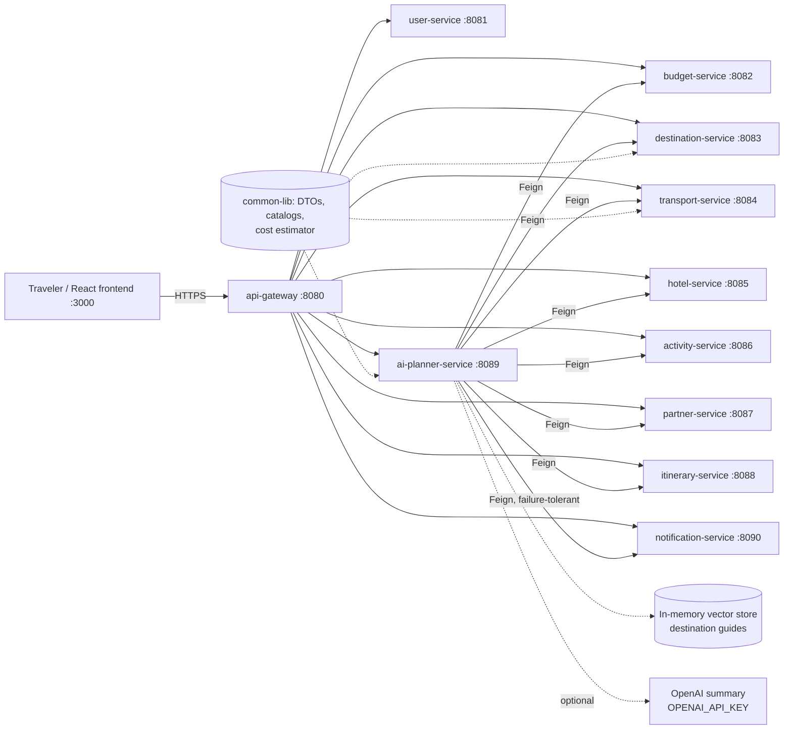
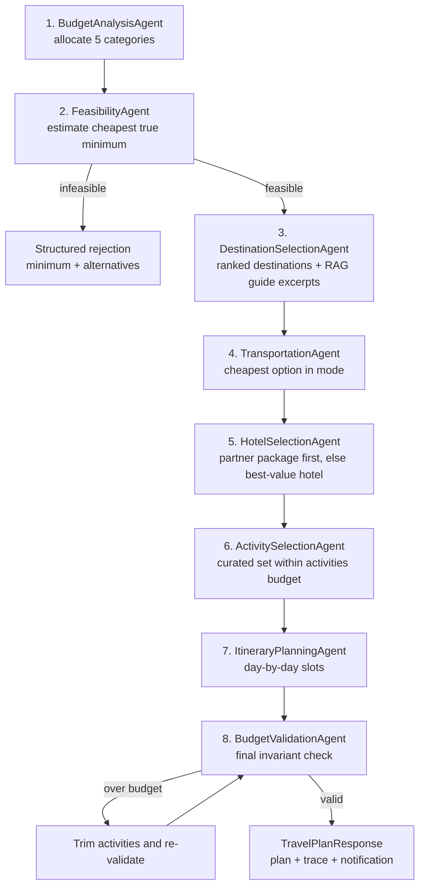
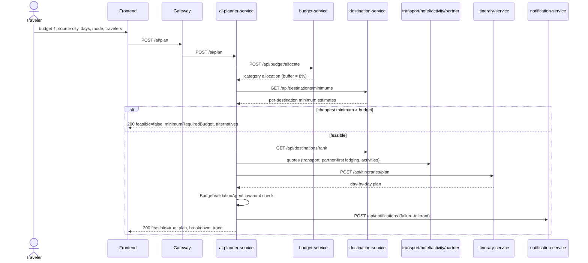

# Nethra Travel AI — Architecture

> **"Where you can't see, we help you see."**
> An autonomous, budget-first travel planning platform. The traveler gives a budget, a source city, a number of days and a transport mode — the system decides where they can go, how, where they stay and what they do each day, or it honestly refuses and explains the minimum budget that would work.

## 1. Design principles

1. **Budget-first, never budget-breaking.** Every plan is validated against the hard invariant
   `transport + hotel + food + activities + emergency buffer ≤ budget`, with the buffer always
   exactly **8% of the budget** held back. A plan that violates the invariant is never emitted.
2. **Honest refusal.** If no destination fits, the planner returns a structured rejection
   (HTTP 200, `feasible=false`) with a computed `minimumRequiredBudget`, cheaper transport
   modes with their minimums, cheaper destinations with their minimums, and actionable
   suggestions (shorter trip, different mode). No itinerary is generated for an infeasible
   trip — the spec example (Hyderabad, 4 days, flight, ₹15,000) is rejected with a computed
   minimum of **₹15,196**.
3. **Partner packages first.** Where a partner package (hotel + pickup + tours bundled below
   the sum of parts) exists and fits, it is selected instead of separate hotel + activities,
   and the hotel provider is never called for that trip (verified by a test with
   `verify(hotelClient, never())`).
4. **Provider abstraction everywhere.** Flights, trains, buses, cars, hotels and activities
   sit behind provider interfaces. The reference implementation ships deterministic **mock
   providers** (labeled as such); a production deployment swaps in real aggregator APIs
   without touching the planner.
5. **Auditable agents.** The planning workflow is a LangGraph-style state machine of eight
   named agent nodes. Every decision is appended to an `agentTrace` returned with the plan,
   so any recommendation can be replayed and explained.
6. **Works with no external keys.** The optional LLM summary layer is used only when
   `OPENAI_API_KEY` is present; otherwise a deterministic template summary is produced. The
   platform is fully functional in fallback mode.

## 2. System diagram

## 3. Module map

| Module | Port | Responsibility |
|---|---|---|
| `common-lib` | — | Shared DTOs, money handling (INR, 2-dp rounding), `BudgetCategory` enum, destination/activity/partner catalogs, static distance-based transport pricing matrix, `TripCostEstimator` (feasibility arithmetic), error model. |
| `api-gateway` | 8080 | Spring Cloud Gateway (MVC). Routes `/api/**` and `/ai/**` to services; global CORS for the frontend. |
| `user-service` | 8081 | Registration, login, JWT issue/validate (jjwt 0.12.x), BCrypt password hashing, in-memory user store seeded with `demo@nethra.ai / password123`. |
| `budget-service` | 8082 | Budget allocation across the five categories (mode-specific splits normalized to the 92% spendable share) and a feasibility precheck. |
| `destination-service` | 8083 | 14 curated Indian destinations, scoring (value-for-money weighted by budget fit, distance cost, rating, days fit), ranked recommendations, per-destination minimum estimates, guide text. |
| `transport-service` | 8084 | `TransportProvider` interface with mock flight/train/bus/car providers over the shared pricing matrix; deterministic date-hash variation. |
| `hotel-service` | 8085 | `HotelProvider` interface + mock provider generating deterministic hotels per destination, priced by destination cost index and budget tier, sorted by value score. |
| `activity-service` | 8086 | `ActivityProvider` interface + curated activities (6 per destination, 84 total) with price, duration and category. |
| `partner-service` | 8087 | Partner package dataset (7 packages) and quotes; packages bundle hotel + pickup + tours below the sum of parts. |
| `itinerary-service` | 8088 | Day-by-day planner: activities distributed across morning/afternoon/evening slots; arrival and departure days kept lighter. |
| `ai-planner-service` | 8089 | The orchestrator: `TravelGraph` state machine (8 agents), Feign clients to all services, MCP-style tool registry (`GET /ai/tools`), hashing-embedding RAG over destination guides, optional OpenAI summary with template fallback, plan persistence (JPA). |
| `notification-service` | 8090 | Accepts notification requests (EMAIL/SMS/ALERT), mock-sends by logging, stores and exposes history. |
| `frontend` | 3000→80 | React 18 + TypeScript + Vite + Material UI, served by nginx which proxies `/api/` and `/ai/` to the gateway. |

## 4. The agentic workflow

`TravelGraph` executes eight agent nodes in a fixed order. Each node reads/writes the shared
`TravelState` and appends an `AgentStep {agent, decision, detail}` to the trace.

## 5. Plan request sequence

## 6. The budget model

* Spendable share = 92% of budget; **EMERGENCY_BUFFER = 8%** always.
* Mode-specific splits of the spendable share (transport share grows for flight, shrinks for
  bus/car; hotel and food scale with days) — see `budget-service`.
* Feasibility arithmetic lives in one place: `TripCostEstimator` in `common-lib`. For a
  destination, the true minimum = cheapest transport (requested mode) + food + cheaper of
  (budget-tier lodging + cheapest activities) vs (partner package quote) — then divided by
  0.92 so the 8% buffer is included in the required budget.
* Worked spec example — Hyderabad, 4 days, flight, 1 traveler, cheapest destination Mysuru:
  transport ₹5,280 + lodging/activities ₹5,100 + food ₹3,600 = ₹13,980; ₹13,980 / 0.92 =
  **₹15,196 minimum required budget** — hence a ₹15,000 flight request is rejected, and the
  rejection offers TRAIN/BUS/CAR minimums and cheaper destinations.

## 7. Data and storage

* Default profile: every service runs standalone on embedded **H2** (`create-drop`) with its
  catalog data in `common-lib`; no external database is needed to run the platform.
* `application-postgres.yml` in each service plus `db/schema.sql` define the production
  PostgreSQL shape (one schema, tables matching the JPA entities).
* The transport pricing matrix is static and distance-based: great-circle distance from
  coordinates, road distance = air distance × 1.28; flight = max(₹4,700, ₹3,600 + ₹2.8/km),
  train/bus/car have their own per-km formulas with floors. It covers all 14 destinations
  from any source city, including the six major hubs (Hyderabad, Delhi, Mumbai, Bengaluru,
  Chennai, Kolkata).

## 8. RAG and the tool registry

* **RAG:** destination guide snippets are embedded with a 128-dimension hashing embedder
  into an in-memory vector store; `DestinationSelectionAgent` retrieves the top excerpts for
  the chosen destination and returns them as `guideHighlights` with the plan.
* **MCP-style tools:** `GET /ai/tools` returns tool definitions (name, description, JSON
  input schema) for `plan_trip`, destination ranking, minimum estimation and budget
  allocation, so an external agent host can call the platform as tools.

## 9. Deployment topology

* **Docker Compose:** all 11 Java services + gateway + frontend; the planner and gateway get
  service-name URLs via environment; the frontend's nginx proxies `/api/` and `/ai/`.
* **Kubernetes:** one Deployment + Service per service under `k8s/`, a namespace, and an
  nginx Ingress routing `/` to the frontend and `/api`, `/ai` to the gateway.
* **Helm:** `helm/nethra-travel-ai/` templates Deployments/Services for all services from
  `values.yaml`.

## 10. Honest limitations

* All travel inventory is **mock data** — deterministic, curated, and labeled as mock in code
  and docs. Prices are planning estimates, not bookable fares.
* No payment or booking execution exists; the platform plans, it does not purchase.
* The sandbox used to build this project intercepts direct TCP sockets from JVM processes,
  so live cross-service smoke tests were run per-service (health + direct endpoint calls);
  the full planner graph is verified end-to-end by the mocked-Feign integration tests.
